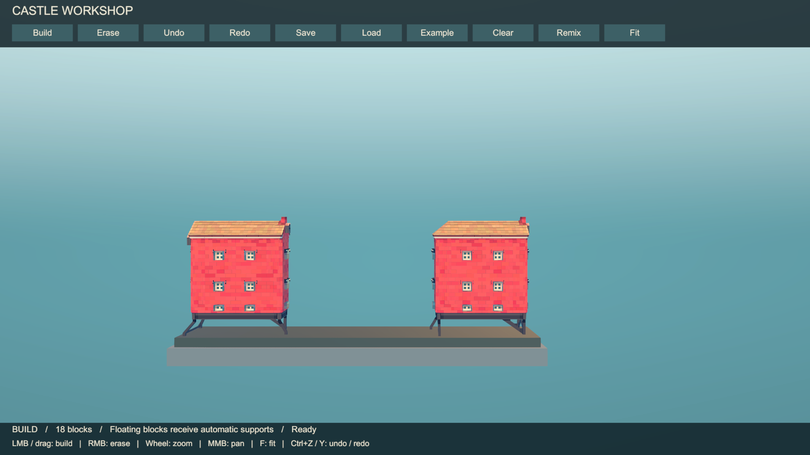
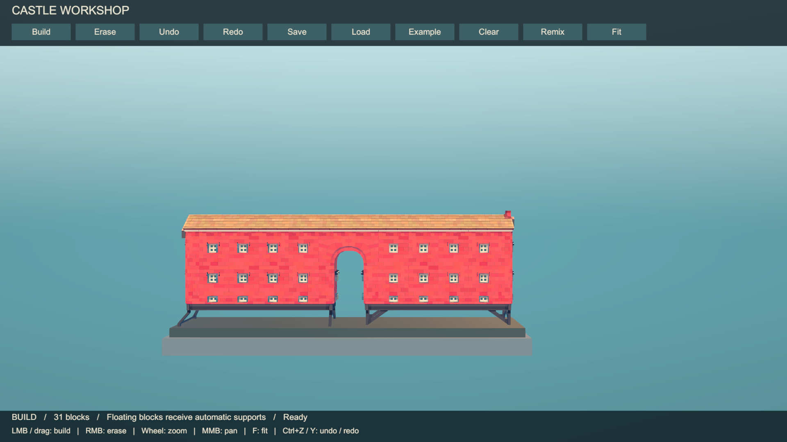
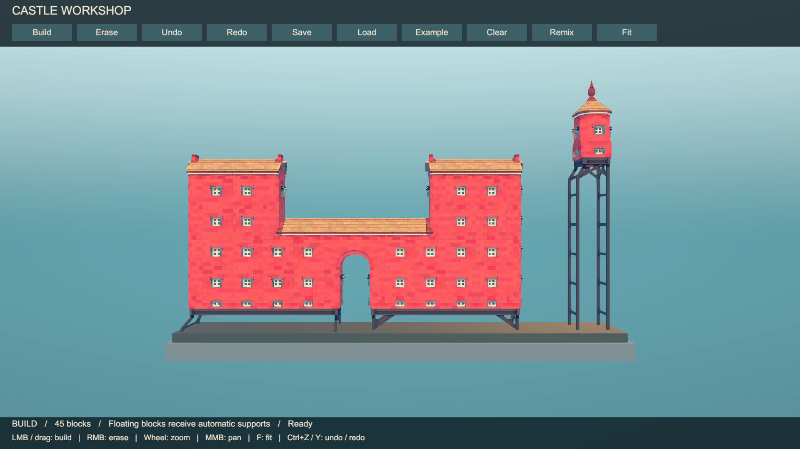

# TownStudy

A Unity technical demo for interactive modular construction, automatic connections, and procedural mesh selection.

**Unity 6000.3.24f1 · HDRP · Perspective side view**

## Preview

### 1. Base layout

### 2. Connected structure

### 3. Expanded layout

Screenshots captured from the running demo using the same camera view.

## Run

Open the project in Unity, load `Assets/Scenes/SideViewBuilder.unity`, and press Play.

- Left click / drag: build. Right click: erase.
- Mouse wheel: zoom. Middle drag: pan. **F**: fit view.
- Toolbar: undo, redo, save, load, clear, example, and remix.

A construction and rendering experiment; driving and combat are not implemented.
